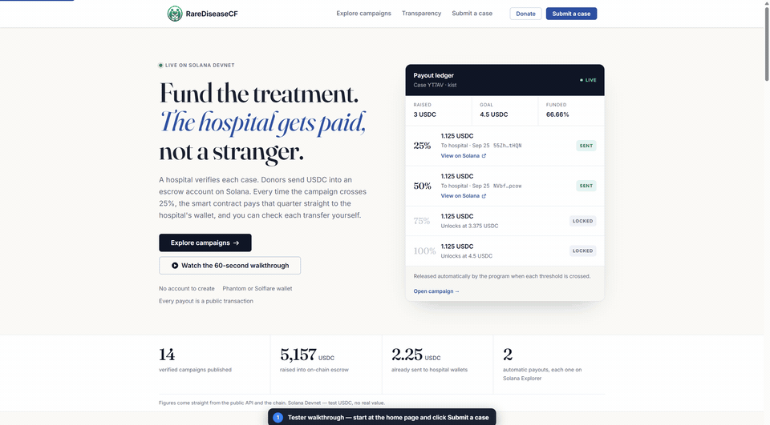

# RareDiseaseCF

**Crowdfunding for rare disease treatment, secured by a Solana smart contract.**
Every campaign is verified by the patient's hospital, the goal is locked to the real treatment gap, and donations can only ever be paid to the hospital's wallet, automatically, every 25%.



- **Smart contract (Solana Devnet):** [`3ChG4eL5EvhrELWbAZs3cdVt8P9X1CfrRwfF6gqfKG9d`](https://explorer.solana.com/address/3ChG4eL5EvhrELWbAZs3cdVt8P9X1CfrRwfF6gqfKG9d?cluster=devnet)
- **Full walkthrough video (1 min):** [`public/walkthrough/walkthrough.mp4`](public/walkthrough/walkthrough.mp4)
- **Detailed write-up:** [`PROJECT_OVERVIEW.txt`](PROJECT_OVERVIEW.txt)

---

## The problem

Families facing rare disease treatment turn to crowdfunding, but:

1. **Donors can't tell which stories are real.**
2. **Campaigns ask for the wrong amount**, often the full cost even when insurance already covers part of it.
3. **Money goes to a personal account**, with no guarantee it's spent on treatment.
4. **Patients have to post private medical details publicly** to be believed.

## How RareDiseaseCF fixes it

| Problem | Fix |
|---|---|
| Trust | The patient's **own hospital verifies the case** through a single-use link sent to a whitelisted hospital email. Verified campaigns show "Verified by name@hospital". |
| Wrong amount | The server calculates the goal: **treatment cost − insurance/assistance − patient contribution**. The hospital confirms it and it's locked. |
| Misuse | Donations go into a **per-campaign escrow controlled by the smart contract**. Each 25% raised is sent **straight to the hospital's wallet**; nobody on the team can withdraw. |
| Privacy | Medical documents are **encrypted and seen only by the verifying hospital**. The public sees the goal, progress and payouts. **No health data goes on-chain.** |

## How it works

1. **Submit privately.** A patient or caregiver enters treatment, cost, assistance, the hospital's email, documents and an optional campaign photo. No crypto wallet needed.
2. **Hospital verifies.** The hospital opens a signed, single-use link (valid 24 h), reviews the documents, confirms the numbers and adds the Solana wallet that will receive funds.
3. **Campaign goes live.** The goal is locked and the server creates the campaign's escrow on Solana, bound to the hospital's wallet.
4. **Donors give USDC** from Phantom or Solflare, optionally anonymously. The server checks every donation on-chain before counting it.
5. **Hospital gets paid automatically.** When the amount raised crosses 25%, 50%, 75% or 100%, the smart contract sends that share to the hospital. Each payout links to its Solana transaction.
6. **Campaigns end after 180 days.** Anything raised but not yet paid goes to the hospital, so funds can never get stuck.

Everything appears on a public **Transparency** page: a plain-language timeline, milestone payouts and a donor leaderboard, with no medical details.

## What the smart contract enforces

- Money can only go to the **hospital wallet registered for that campaign**.
- Payout amounts are computed on-chain (a milestone share, or the remaining balance after expiry), **never chosen by the caller**.
- Milestone payouts and expiry releases are **permissionless**: anyone can trigger them, but the destination is fixed, so the server can't redirect funds.
- The same milestone **can't be paid twice**, and total payouts can't exceed what was raised.
- **No patient data** is stored on-chain.

Source: [`onchain/programs/rarediseasecf`](onchain/programs/rarediseasecf) (Rust, Anchor).

---

## Try it (demo script)

Runs on **Solana Devnet**: test USDC with no real value.

1. **Submit a case** at `/submit`. For the hospital email, use **`aa@aa.aa`**, the built-in test hospital inbox (Devnet only).
2. After submitting, a popup shows the **hospital's verification email**. Open the link, review the documents, choose **USDC payout**, paste a Devnet wallet address and **approve**.
3. The campaign appears on **`/campaigns`** with the verified badge.
4. **Donate** at least 25% of the goal with a Devnet wallet. The 25% milestone is **sent to the hospital automatically** and shows **Sent · View on Solana**.
5. Open **`/transparency`** to see the timeline and the payout, with no documents or medical details shown.

Donor wallet setup: Devnet SOL from [faucet.solana.com](https://faucet.solana.com), and Devnet USDC (mint `4zMMC9srt5Ri5X14GAgXhaHii3GnPAEERYPJgZJDncDU`) from [faucet.circle.com](https://faucet.circle.com).

## Run it locally

Requirements: Node.js 20.19+ or 22.12+, Docker (for PostgreSQL).

```powershell
cp .env.example .env
npm install
npm run db:up        # PostgreSQL in Docker
npm run db:migrate
npm run dev          # web app on http://localhost:5173, API on :8787
```

Fill in `.env` before starting:

- **`DATA_ENCRYPTION_KEY`**: generate with `node -e "console.log(require('crypto').randomBytes(32).toString('base64'))"`
- **`PLATFORM_AUTHORITY_SECRET_KEY`**: a server-only Solana keypair that signs escrow actions. Never put it in a `VITE_*` variable.
- The Devnet program ID and USDC mint are already set in `.env.example`.

Using a new platform key or cluster? Initialise it once with `onchain/scripts/devnet-init-platform.ts`, then `devnet-upsert-registries.ts`. Every variable is documented in [`docs/ENV.md`](docs/ENV.md).

Without SMTP configured, hospital verification links are printed in the API log instead of emailed.

## Architecture

```
React + Vite (web)  ──HTTPS/JSON──▶  Express API (Node, TypeScript)  ──SQL──▶  PostgreSQL
        │                                    │
        └── donor wallet signs ──▶  Solana program (Anchor)  ◀── server relayer signs
                                    per-campaign USDC escrow        milestone payouts
```

| Layer | Tech |
|---|---|
| Web app | React 18, TypeScript, Vite, React Router, Solana Wallet Adapter (Phantom, Solflare) |
| API | Node.js, Express, Drizzle ORM, Multer, AES-256-GCM encryption, HMAC-signed magic links |
| Database | PostgreSQL (Docker Compose locally) |
| Smart contract | Solana, Anchor (Rust), SPL Token (USDC) |

## Security and privacy

- Case details, documents and hospital payout details are **encrypted at rest** (AES-256-GCM).
- Hospital links are **HMAC-signed, single-use, expire within 24 hours** and are bound to one case and one email. Personal email domains (Gmail, Outlook…) can't act as a hospital.
- Uploads are checked by **actual file contents**, not just extension. Campaign photos have **GPS and camera metadata stripped**.
- Public APIs use an **explicit field allowlist**, so internal IDs, wallets and medical text can't leak by accident.
- The platform signing key **lives only on the server**; the web app holds no private keys.
- Rate limiting on submissions, verification links, donations and admin actions.

## Tests

```powershell
npm run typecheck
npm run test:server      # 108 tests: funding-gap math, milestone rules, double/over-payout
                         # protection, on-chain donation verification, magic links, security
cd onchain; npm run validate:linux-docker   # Anchor build + program tests (Docker)
```

## Project layout

```
src/        React web app (pages, components, Solana transaction builders)
server/     Express API (cases, hospitals, campaigns, donations, milestones, escrow relayer)
onchain/    Solana program (Anchor/Rust), tests and Devnet scripts
docs/       Environment reference, walkthrough media, development log
```

## Status

- **Real:** the full app, API and database; hospital verification; USDC donations, milestone payouts and expiry payouts as real transactions on **Solana Devnet**. Nothing is simulated.
- **Coming soon** (labelled in the app): card/fiat donations, bank payouts for hospitals.
- **Not** a certified healthcare system. On Devnet, use synthetic data and test wallets only.

The day-by-day build history is in [`docs/devlog.md`](docs/devlog.md).
